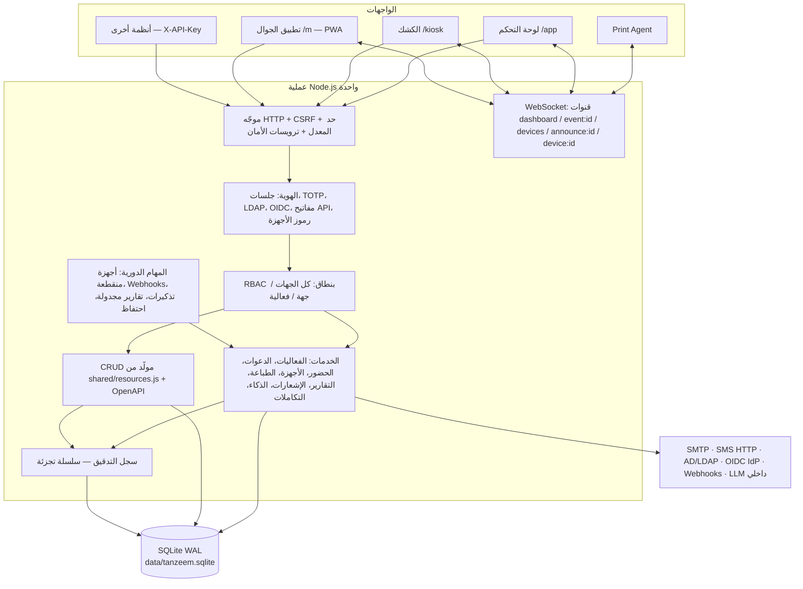
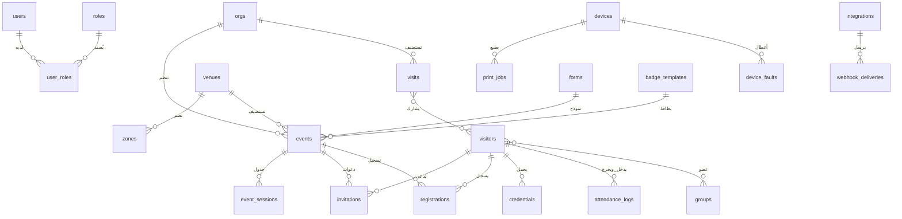

# المعمارية



## هيكل المجلدات

```
server/
  app.js            التجميع: المسارات، معالجة الطلبات، WebSocket، المهام الدورية، المقاييس
  config.js         الإعدادات من .env
  db.js             مخطط قاعدة البيانات (30 جدولاً) والمساعدات
  security.js       scrypt، AES-256-GCM، HMAC، TOTP، توقيع رموز QR
  auth.js           الجلسات والدخول المحلي/LDAP/OIDC والتحقق الثنائي
  resources.js      CRUD عام: بحث، فلاتر، ترتيب، ترقيم، تصدير، نطاق، تدقيق
  audit.js          سجل التدقيق بسلسلة تجزئة
  realtime.js       مركز WebSocket
  exporter.js       CSV وكاتب xlsx مدمج
  openapi.js        توليد OpenAPI 3.1
  seed.js           البيانات التجريبية
  cli.js            admin | seed-demo | backup | restore | verify-audit | retention
  services/         events · people (الزوار، المجموعات، الزيارات) · attendance · devices · notifications · reports · ai · integrations · admin
shared/             permissions.js (الوحدات والأدوار) · resources.js (تعريف الموارد والتحقق) · badge.js (SVG/ZPL) · messages.js (قوالب الرسائل)
web/
  app.html … m.html الصفحات المدخلية
  src/core/         dom، i18n (ar/en)، api، ws، theme، ui، charts، qr، scanner، printing، style.css
  src/app/          الهيكل والموجّه + components (table/form) + pages (16 صفحة + event-tabs الخمس)
  src/kiosk/        واجهة الكشك
  src/mobile/       تطبيق الجوال
tools/print-agent/  وكيل الطباعة
tests/              unit · server (تكامل) · e2e (Playwright) · load.mjs · k6-load.js · lint.mjs
deploy/             serv00/ (النشر) · nginx.conf · certs/
docs/               الوثائق
```

## نموذج البيانات (أهم الكيانات)



جداول إضافية:

| الجدول | الدور |
|---|---|
| `presence` | الإشغال اللحظي ومنع الدخول المزدوج |
| `sessions` | جلسات الدخول |
| `notifications` | التنبيهات |
| `api_keys` | مفاتيح الأنظمة الأخرى |
| `report_schedules` | التقارير المجدولة |
| `connections` | التعارف بين المشاركين |
| `settings` | الإعدادات |
| `audit_log` | سجل التدقيق |
| `integration_logs` | سجل التكاملات |
